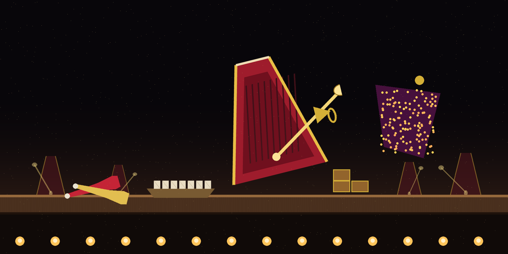
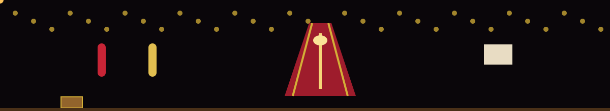

# AI-Image-Generator

**The Metronome Maker's Pyramid Shelf**
_Pictures, in tempo. One instrument keeps time while it flies, and every prompt lands on the boards as a finished frame._




## Implementation
_What the one file does, stated plain_


Google AI Studio Imagen v4 Ultra

This project is complete and runnable. Run it:

```bash
python3 generate.py "a violet nebula over a dark ocean"
python3 generate.py "geometric sunrise" --style waves --size 800
```

Fully offline: the same prompt always generates the same PNG.

> Rosin box note: the shelf holds one program, generate.py, and nothing else needs installing beyond Python 3.
