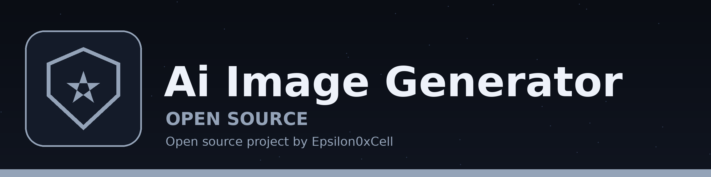

# AI-Image-Generator

Google AI Studio Imagen v4 Ultra

## Implementation

This project is complete and runnable. Run it:

```bash
python3 generate.py "a violet nebula over a dark ocean"
python3 generate.py "geometric sunrise" --style waves --size 800
```

Fully offline: the same prompt always generates the same PNG.
